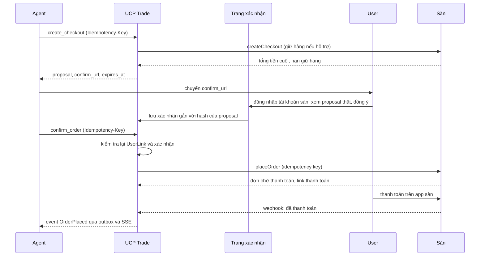

# Giới thiệu

Tài liệu này đi kèm báo cáo Đồ án 2 (bản bảo vệ, v1.0, 234 trang). Báo cáo v1.0 giữ nguyên. Phụ lục gồm bốn phần:

- **Phần A. Đính chính:** các chỗ số liệu, tên gọi hoặc mô tả không khớp nhau giữa các phần của báo cáo và tài liệu làm việc. Mỗi mục ghi vị trí, nội dung hiện tại và nội dung đúng.
- **Phần B. Điểm yếu thiết kế:** các vấn đề phát hiện khi chạy thử kịch bản lỗi (stress test) trên thiết kế v1.0. Đây không phải lỗi đánh máy mà là lỗ hổng trong thiết kế.
- **Phần C. Thiết kế v1.1:** đề xuất sửa các điểm yếu ở Phần B, kèm 5 ADR mới (ADR-006 đến ADR-010).
- **Phần D. Hướng hiện thực:** thứ tự xây dựng nếu triển khai UCP thành phần mềm chạy được.

Phần C là thiết kế trên giấy, chưa được hiện thực hay kiểm thử. Các con số như TTL và giới hạn là giá trị khởi điểm cần đo lại khi có hệ thống chạy thật.

# Phần A. Đính chính

Đối chiếu với báo cáo PDF bản cuối (234 trang) và các tài liệu trong thư mục `Thực hiện`. Các tài liệu làm việc (APISpec, RiskAnalysis, ADRs, DomainEvents, TraceabilityMatrix, TechStack) đã được sửa theo bảng này.

| # | Vị trí | Hiện tại | Đính chính |
|---|---|---|---|
| A1 | 4.6.2.5 Deployment View; Tech Stack (Methodology) | "14 containers" | **13 containers**: 6 service, 5 PostgreSQL database, Redis, RabbitMQ (khớp bảng 4.6.2.1) |
| A2 | 2.8.2, 2.8.3, 2.9.2 (3 chỗ) | "35 capabilities" | **32 capabilities** (Level 2 trong Feature Tree, 6 nhóm). Bảng Capability Map 4.1.3 là bản tóm tắt 19 dòng |
| A3 | 2.8.3; 5.1; APISpec mục 1.1 | "20 API endpoints (… + 2 internal)" | **18 endpoints**, gồm 16 đường dẫn HTTP vì `create_checkout`, `confirm_order`, `cancel_order` dùng chung `POST /intent`. Không có endpoint internal nào được đặc tả |
| A4 | 3.5 (DDD); 5.1 bảng kết quả | "40+ events" | **41 domain events**. DomainEvents.xlsx: dòng tổng kết Trade & Order ghi 14, thực tế 13 (sự kiện 18 đến 30) |
| A5 | 2.8.3 ví dụ truy xuất; 4.6.3.4 CheckoutController | `POST /checkouts` | `POST /intent {method: "create_checkout"}` (T1). API không có `/checkouts` |
| A6 | 4.7.1.4 ADR-004 (Decision) | Intent: `create_checkout, confirm_order, cancel_order, initiate_payment, link_identity` | Intent: `create_checkout, confirm_order, cancel_order`. Liên kết identity dùng REST `POST /agents/{id}/links` (I2). Thanh toán được khởi tạo bên trong `confirm_order` |
| A7 | 4.11 Tổng kết rủi ro | "4 CAO, 7 TRUNG BÌNH, 2 THẤP" | **4 CAO, 8 TRUNG BÌNH, 1 THẤP** (CAO: R-01, 05, 07, 08. THẤP: R-12. Còn lại TRUNG BÌNH) |
| A8 | 4.11 Risk Matrix | R-10, R-11 ở ô (XS Trung bình, Tác động TB); R-13 ở hàng XS Trung bình; R-12 ở hàng XS Thấp | Theo chính bảng rủi ro: **R-10, R-11** ở ô (XS Trung bình, Tác động Cao); **R-13** ở ô (XS Cao, Tác động TB); **R-12** ở ô (XS Cao, Tác động Thấp) |
| A9 | 4.8.4.2 Order States; bảng `orders.status` | Không có `pre_ordered`, nhưng UC-08 tạo Order với `status = pre_ordered` | Thêm `(init) → pre_ordered` (UC-08), `pre_ordered → processing` khi hàng về, `pre_ordered → cancelled` khi user hủy. Enum `orders.status` thêm `pre_ordered` |
| A10 | 4.8.4.3 Payment States | Terminal: `succeeded, refund_completed`. `failed` sau lần thử thứ 3 không có trạng thái kết thúc | Terminal: `succeeded, refund_completed, failed` (`failed` là terminal khi đã thử đủ 3 lần) |
| A11 | 4.2.5 BR-21 | "Khi PaymentFailed, Trade release InventoryReservation và cho phép user thử lại" | Mâu thuẫn với UC-02 EXC-2 và bảng trạng thái Reservation (giữ hàng để thử lại, chỉ release sau lần thứ 3). Sửa BR-21: **giữ reservation trong lúc thử lại (tối đa 3 lần); release sau lần thất bại thứ 3 hoặc khi TTL hết** |
| A12 | 4.5.1.3 UC-03 bước 5; 4.9.2.4 `cancel_order` | "Trade release InventoryReservation" | Reservation đã ở trạng thái `converted` (terminal) từ lúc OrderPlaced. Sửa: **Trade gọi `PlatformAdapter.cancelOrder`, sàn hoàn hàng về kho** |
| A13 | 4.5.1.2 UC-02 Postconditions | "Inventory reserved" | "Reservation converted (hàng đã bán)" |
| A14 | 2.9.4 SWOT | Opportunities: "Chưa có chuẩn commerce cho AI Agent" | Không đúng tại thời điểm làm đồ án: ACP (OpenAI và Stripe) ra mắt 29/09/2025, Google UCP ra mắt 11/01/2026, và báo cáo đã trích Google UCP Guide ở [16]. Sửa Opportunities: **"Các chuẩn AI commerce mới xuất hiện (ACP, Google UCP), chưa phủ các sàn Việt Nam (Shopee, Tiki, Lazada)"**. Thêm vào Threats: **"ACP và Google UCP được Big Tech hậu thuẫn và đã có đối tác bán lẻ lớn"** |
| A15 | 5.5 Hướng phát triển; TechStack.xlsx | v1.5 "implement prototype bằng Java/Spring Boot" | Bảng container 4.6.2.1 ghi cả 6 service là **Python / FastAPI**. Thống nhất theo Python / FastAPI |
| A16 | 4.9.1 bảng tổng hợp, dòng T6 | `/shipping/options?address=...`, auth `read_catalog` | Theo phần chi tiết 4.9.2.4: `/shipping/options?city={c}&district={d}`, auth JWT |
| A17 | 4.3.1 Objective Chain | G1 đến G4 đặt tên khác 4.2.1 (G2 "Đơn giản hóa tích hợp", G3 "An toàn", G4 "Mở và khả mở") | Bảng Objective Chain dựng trên cách đặt tên của 4.3.1 nên không đổi tên. Ánh xạ: 4.3.1 G1 = 4.2.1 G1; G2 = phần "developer" của G1; G3 = G4; G4 = G2 + G3 |
| A18 | TraceabilityMatrix.xlsx, sheet Traceability Matrix | Cột BR của từng UC chỉ nêu 19/25 BR, trong khi sheet BR Coverage map đủ 25 | Bổ sung: UC-01 thêm BR-02; UC-02 thêm BR-11, BR-12, BR-21, BR-24, BR-25; UC-03 thêm BR-24, BR-25. Hai sheet giờ khớp nhau |
| A19 | Ngày các ADR | Báo cáo: 001 28/02, 002 08/03, 003 15/03, 004 22/03, 005 05/04. ADRsl.docx: 001 15/03, 002 19/03, 003 22/03, 004 28/02, 005 05/04 | Hai nguồn lệch nhau, và mỗi nguồn có ít nhất một ngày trước ngày bắt đầu dự án (09/03/2026). **Không sửa** vì không còn bằng chứng về ngày thật. Ghi nhận ở đây |

Các điểm đã kiểm tra và **không** phải lỗi:

- "17 tables" đúng: Identity 4, Catalog 4, Trade 6, Payment 2, Notification 1.
- UC-02 có 13 bước (đặc tả use case) và quy trình swimlane Checkout có 19 bước. Đây là hai artifact khác nhau, không mâu thuẫn.
- Payment `succeeded → refund_initiated`: báo cáo đã giải thích refund là vòng đời mở rộng, `succeeded` vẫn là terminal của payment.

# Phần B. Điểm yếu thiết kế

Chạy thử từng kịch bản lỗi trên thiết kế v1.0 và đối chiếu với báo cáo. Nguyên nhân gốc chung: **Trade đóng vai chủ sở hữu tồn kho, giá và trạng thái đơn, trong khi thực tế sàn mới là bên nắm các dữ liệu đó.** UCP chỉ có bản sao.

| # | Kịch bản | Thiết kế v1.0 làm gì | Hậu quả | Căn cứ trong báo cáo |
|---|---|---|---|---|
| B1 | Agent tự xác nhận đơn thay user | UC-02 bước 6 đến 8: Agent trình bày proposal, user đồng ý với Agent, Agent gửi `confirm_order` | `confirm_order` không có trường xác nhận nào của user. `user_confirmation_token` chỉ xuất hiện trong R-08, không có trong API hay data model. BR-16 thực chất không được thực thi | 4.5.1.2, 4.9.2.4, R-08 |
| B2 | 2 Agent mua món hàng cuối cùng cùng lúc | `available_qty` nằm ở Catalog DB, reservation nằm ở Trade DB | `SELECT FOR UPDATE` (R-05) không thể khóa xuyên 2 database, và nguyên tắc "không cross-DB query" cấm điều đó. Cả hai có thể giữ cùng một đơn vị hàng. Sàn vẫn bán hàng đó qua website của sàn | R-05, 4.6.2.4, BR-10, BR-15 |
| B3 | Giá và tồn kho "real-time" | BR-10: tính lại mỗi lần, không cache. R-06: giá luôn query real-time khi checkout | Catalog DB là bản đồng bộ, DataSyncWorker chạy mỗi 5 phút và có thêm Redis cache 5 phút. "Real-time" thực tế là dữ liệu cũ tới 5 đến 10 phút | BR-10, R-06, 4.6.3.3 |
| B4 | Sàn đã giao hàng, Agent gửi hủy | Trade kiểm tra status trong Trade DB | Không có kênh nào đưa trạng thái `shipped` từ sàn về UCP. Trade có thể chấp nhận hủy dựa trên trạng thái cũ (BR-17) | 4.8.4.2, UC-03 |
| B5 | Timeout sau khi user đã trả tiền, Agent gửi lại | `confirm_order` trả về đồng bộ cả `payment_status` | User xác thực OTP trên app sàn có thể mất vài phút. Không có idempotency key trong API (R-04 có nhắc nhưng chưa thiết kế), nên gửi lại có thể tạo 2 đơn và trừ tiền 2 lần | 4.9.2.4, R-04 |
| B6 | Reservation hết hạn giữa lúc thanh toán | Reservation TTL 15 phút, checkout TTL 30 phút | Từ phút 15 đến 30, checkout vẫn `active` nhưng không còn giữ hàng. R-12 đề xuất kéo dài checkout lên 60 phút làm khoảng hở lớn hơn | BR-13, BR-14, R-12 |
| B7 | Ai giữ tiền | BR-19, BR-20: tiền đi qua cổng của sàn. ADR-005: Payment service có Strategy để thay MockProvider bằng StripeAdapter | Hai mô hình thanh toán mâu thuẫn. Nếu thay bằng Stripe thì UCP trở thành bên thu tiền (merchant of record), trái BR-19 | BR-19, BR-20, ADR-005 |
| B8 | User hủy liên kết khi session còn sống | BR-08: mất quyền ngay | JWT được kiểm tra cục bộ và sống 1 giờ. Nếu không kiểm tra lại mỗi lần gọi, Agent vẫn dùng được tới khi token hết hạn | BR-08, ADR-002 |
| B9 | Agent hủy đơn không hỏi user | `cancel_order` chỉ cần scope `create_order` | UC-03 không trích BR-16. Agent có thể hủy và kích hoạt hoàn tiền mà user không biết, trái G4 ("human-in-the-loop cho mọi giao dịch tài chính") | UC-03, 4.9.2.4, G4 |
| B10 | API key xem đơn | ADR-002: API key mặc định có `read_catalog` và `view_order` | Đơn hàng thuộc về user, nhưng API key không gắn với user nào | ADR-002 |
| B11 | RabbitMQ ngừng hoạt động | ADR-001: broker chết chỉ ảnh hưởng notification | Bù trừ của Trade (release khi PaymentFailed, CheckoutExpired) phản ứng theo event. Không có thành phần nào được nêu là bên chạy hẹn giờ hết hạn. Broker chết thì hàng có thể bị khóa | ADR-001, 4.6.2.2 mục D |
| B12 | Redis ngừng hoạt động | Session, quota, rate limit và cache đều ở Redis | Không có rủi ro nào trong 13 rủi ro đề cập Redis. Fail open thì mất giới hạn, fail closed thì toàn hệ thống dừng | 4.6.2.2 mục H, 4.11 |
| B13 | Chạy nhiều Gateway (giải pháp R-01) | SSE giữ kết nối ở một instance | Không có cơ chế chuyển event đến đúng instance đang giữ kết nối, hoặc phát lại từ `Last-Event-ID` | R-01, 4.9.2.6 |
| B14 | Một sàn bị chậm | R-03: timeout 5 giây mỗi lần gọi; R-01: circuit breaker | Chưa tách connection pool theo từng sàn, nên một sàn chậm vẫn có thể chiếm hết tài nguyên dùng chung | R-01, R-03 |
| B15 | Giữ hàng để phá (flash sale) | BR-18 giới hạn số lượng mua | Không giới hạn số checkout đang mở mỗi user. Giữ hàng 15 phút, để hết hạn, lặp lại. Một user có thể liên kết nhiều Agent | BR-18, DT-3 |
| B16 | Lộ Identity DB | `user_links` không có cột token | Để đặt hàng thay user, UCP cần token OAuth của sàn. Data model không nói token lưu ở đâu, mã hóa thế nào, hết hạn giữa luồng thì sao | 4.8.2.1, R-07, R-09 |
| B17 | Thiếu intent | UC-02 ALT-2, ALT-3 dùng `SelectShippingMethod`, `ApplyPromotion`. Bảng trạng thái dùng `CancelCheckout`. R-12 cho phép "extend session" | Không intent nào trong 4 intent này có trong API | UC-02, 4.8.4.1, R-12, 4.9 |
| B18 | Một Agent mua trên nhiều sàn | Base URL `https://{platform}.ucp.example.com` | Mỗi sàn một gateway, nên Agent không thể so giá hay dùng một kết nối cho nhiều sàn. Mâu thuẫn với "Agent chỉ biết 1 URL" (ADR-001) | 4.9.1, ADR-001 |

# Phần C. Thiết kế v1.1

## C1. Một thay đổi gốc

**Sàn là nguồn sự thật (source of truth).** Ở v1.0, Trade giữ tồn kho, giá và trạng thái đơn như dữ liệu của mình. Ở v1.1, UCP điều phối và sàn quyết định.

| UCP nắm | Sàn nắm |
|---|---|
| Danh tính Agent, API key, quota | Tồn kho và việc giữ hàng |
| UserLink, consent, scope | Giá, khuyến mãi, phí ship |
| Bản chụp proposal và bản ghi xác nhận của user | Đơn hàng và trạng thái đơn |
| Ánh xạ đơn UCP sang đơn của sàn | Thanh toán và hoàn tiền (merchant of record) |
| Phân phối event đến Agent | Sổ địa chỉ giao hàng |

Giữ nguyên từ v1.0: 6 Bounded Context, sync cho query và async cho event (ADR-001), database per service (ADR-003), hybrid REST và JSON-RPC (ADR-004), Adapter pattern cho sàn.

## C2. Hợp đồng `PlatformAdapter` mới

v1.0 có 4 method: `searchProducts`, `getProduct`, `createCheckout`, `cancelOrder`.

| Method | Mục đích | Mới? | Sửa |
|---|---|---|---|
| `capabilities()` | Sàn khai báo hỗ trợ gì: giữ hàng, webhook, trang xác nhận do sàn host, COD, hủy một phần | Mới | Cho UCP hành xử đúng với từng sàn |
| `searchProducts` | Tìm kiếm trực tiếp | Giữ | |
| `getProduct` | Chi tiết trực tiếp | Giữ | |
| `getQuote(items, region, shipping, promo)` | Giá, tồn kho, phí ship, giảm giá tại thời điểm gọi | Mới | B3 |
| `shippingOptions(region)` | Hình thức giao hàng và phí theo region của sàn | Mới | B17 |
| `createCheckout(items, region, shipping, promo)` | Checkout trên sàn, tổng tiền cuối, giữ hàng nếu sàn hỗ trợ | Sửa | B2 |
| `renewHold(checkoutId)`, `releaseHold(checkoutId)` | Điều khiển việc giữ hàng | Mới | B6, B11 |
| `placeOrder(checkoutId, idempotencyKey)` | Tạo đơn, trả link thanh toán | Mới | B4, B5 |
| `getOrder(id hoặc idempotencyKey)` | Tra trạng thái, kể cả sau timeout | Mới | B4, B5 |
| `cancelOrder(id, idempotencyKey, onlyIfUnpaid)` | Sàn chấp nhận hoặc từ chối, trả mã hoàn tiền | Sửa | B4, B7 |
| `getRefund(refundRef)` | Trạng thái hoàn tiền | Mới | B7 |
| `parseEvent(headers, body)` | Xác thực và chuẩn hóa webhook từ sàn | Mới | B4 |

Sàn không hỗ trợ giữ hàng: proposal ghi rõ "tồn kho không được đảm bảo". Nếu hết hàng lúc `placeOrder`, Agent nhận `INSUFFICIENT_STOCK` trước khi có tiền nào bị trừ.

Kiểm thử: `MockPlatformAdapter` thay cho `MockProvider`, giữ các chế độ always_succeed, always_fail, random và callback lỗi.

## C3. UC-02 Checkout v1.1

Các bước:

1. Agent gửi `create_checkout` kèm header `Idempotency-Key`.
2. Trade gọi `createCheckout` của sàn. Sàn trả tổng tiền cuối và hạn giữ hàng (nếu có).
3. Trade lưu bản chụp proposal và trả cho Agent: proposal, `confirm_url`, `expires_at`.
4. Agent đưa `confirm_url` cho user.
5. User mở trang xác nhận, **đăng nhập bằng tài khoản sàn**, xem proposal lấy từ bản chụp của UCP (không phải do Agent gửi), rồi đồng ý.
6. Trang xác nhận lưu bản ghi xác nhận gắn với hash proposal, user, Agent và thời hạn. Bản ghi chỉ dùng được một lần.
7. Agent gửi `confirm_order` kèm `Idempotency-Key`.
8. Trade kiểm tra lại UserLink và bản ghi xác nhận, rồi gọi `placeOrder` với cùng khóa idempotency.
9. Sàn tạo đơn ở trạng thái chờ thanh toán và trả link thanh toán. User trả tiền trên app sàn (OTP, FaceID).
Sửa đổi 25/11/2026 (ADR-007): bước 7 và 8 chạy ngay khi user bấm đồng ý ở bước 5, rồi user được chuyển sang trang thanh toán. Agent gọi `confirm_order` để lấy kết quả.

10. Sàn gửi webhook "đã thanh toán". Trade cập nhật đơn và phát `OrderPlaced` qua outbox, Notification đẩy đến Agent qua SSE.

Quy tắc:

- `proposal.expires_at` = thời điểm sớm hơn giữa TTL checkout và hạn giữ hàng, nên checkout còn sống thì hàng vẫn đang được giữ (sửa B6).
- **Trang xác nhận:** do sàn host nếu `capabilities()` cho biết sàn hỗ trợ, nếu không thì UCP host trang dự phòng. Trong cả hai trường hợp, proposal hiển thị lấy từ bản chụp UCP lưu.
- **User phải đăng nhập bằng tài khoản sàn trên trang đó**, và tài khoản đó phải trùng UserLink. Nếu không, ai cầm `confirm_url` (kể cả Agent) cũng bấm đồng ý được (sửa B1).
- Agent không bao giờ cầm thứ gì có thể tự tạo ra để giả mạo xác nhận.
- COD được bảo vệ như các phương thức khác, vì cửa kiểm soát là trang xác nhận chứ không phải OTP thanh toán.
- Tổng tiền tăng: trả `PRICE_CHANGED` và hỏi lại user. Tổng tiền giảm: áp dụng giá mới (BR-11, BR-12).

## C4. Trạng thái

| Đối tượng | Luồng v1.1 | Terminal |
|---|---|---|
| Order | `pending_payment → placed → processing → shipped → delivered`. `pre_ordered → processing`. `pending_payment / placed / processing / pre_ordered → cancelled` | `delivered`, `cancelled` |
| Payment | `pending → processing → succeeded / failed`. `failed → processing` (cùng khóa, tối đa 3 lần) hoặc `failed_final` | `succeeded`, `failed_final` |
| Refund (đối tượng riêng) | `initiated → completed / failed` | `completed`, `failed` |
| Reservation | Phản chiếu việc giữ hàng của sàn: `held → converted / released`, hoặc `none` nếu sàn không hỗ trợ | `converted`, `released`, `none` |

Trạng thái đơn trong UCP là bản cache. Khi hủy, câu trả lời của sàn quyết định (BR-17).

## C5. Độ tin cậy

| Vấn đề | Quy tắc v1.1 |
|---|---|
| Trừ tiền 2 lần khi gửi lại (B5) | Bắt buộc `Idempotency-Key` trên mọi lệnh ghi qua `/intent`. Lưu duy nhất theo Agent, phát lại kết quả cũ trong 24 giờ. Chuyển tiếp khóa sang sàn |
| Timeout sau `placeOrder` | Đánh dấu "đang đối soát", tra bằng `getOrder` theo khóa. Không gửi lại mù quáng |
| Cập nhật đơn (B4) | Ưu tiên webhook, chống trùng theo event ID. Worker đối soát poll các đơn đang hoạt động làm dự phòng |
| Mất event | Transactional outbox trong mỗi database có phát event. Consumer chống trùng |
| Hết hạn (B11) | `ExpiryWorker` trong Trade đọc `expires_at` từ Trade DB. Không cần RabbitMQ để nhả hàng |
| Sàn chậm (B14) | Timeout, connection pool và circuit breaker riêng cho từng adapter. Tìm kiếm nhiều sàn trả `partial: true` khi một sàn không trả lời |
| SSE nhiều instance (B13) | Mỗi Gateway instance có fanout queue riêng và giữ kết nối của các Agent nối vào nó. Phát lại từ log của Notification theo số thứ tự từng Agent. Log là sự thật, SSE là best effort |
| Redis (B12) | 2 instance: Gateway (session, giới hạn) và Catalog (cache), cả hai có failover. Gateway Redis chết: lệnh đọc chạy với bộ giới hạn cục bộ, lệnh ghi `/intent` bị từ chối |

Hai instance Redis làm tổng số container thành 14 (6 service, 5 database, 2 Redis, 1 RabbitMQ).

## C6. Bảo mật

| Vấn đề | Quy tắc v1.1 |
|---|---|
| Thu hồi quyền (B8) | JWT sống 5 phút, kèm kiểm tra session trong Redis mỗi lần gọi. Trade kiểm tra lại UserLink ở `confirm_order` |
| API key (B10) | Chỉ có `read_catalog`. `view_order` cần UserLink |
| Scope (B9) | Thêm `cancel_order`. Bỏ `initiate_payment` (không endpoint nào dùng, xem A6) |
| Hủy đơn (B9) | Dùng cùng trang xác nhận như checkout, nên BR-16 áp dụng cho cả hoàn tiền. Sửa đổi 25/11: đơn chưa thanh toán được hủy ngay và sàn báo cho user (ADR-007) |
| Giữ hàng để phá (B15) | **BR-26 mới:** giới hạn số checkout đang mở mỗi user mỗi sàn, tính trên tất cả Agent (khởi điểm 3), có thời gian chờ sau nhiều lần để hết hạn liên tiếp |
| Token của sàn (B16) | Mã hóa, lưu tách khỏi UserLink, xoay vòng định kỳ. Liên kết hết hạn trả `LINK_EXPIRED` |

## C7. Thay đổi API và dữ liệu

- **Base URL (B18):** một gateway dùng chung `https://api.ucp.example.com/v1`, `platform_id` đi theo từng lời gọi, thay cho `{platform}.ucp.example.com`.
- **Intent bổ sung (B17):** `select_shipping_method`, `apply_promotion`, `cancel_checkout`, `extend_checkout` (tối đa 1 lần, theo R-12, không vượt hạn giữ hàng).
- **Endpoint mới:** `POST /platform-events/{platform}` (nhận webhook từ sàn), `GET /events?after=` (poll dự phòng cho SSE), `GET /confirm/{proposal_id}` (trang xác nhận dự phòng của UCP).
- **Mã lỗi mới (5):** `PLATFORM_UNAVAILABLE` 503, `PRICE_CHANGED` 409, `CONFIRMATION_REQUIRED` 403, `IDEMPOTENCY_CONFLICT` 409, `LINK_EXPIRED` 403. Tổng 18 lên 23.
- **Domain event mới (6):** UserConfirmationRecorded, OrderPendingPayment, PlatformEventReceived, CheckoutExtended, CheckoutCancelled, PlatformLinkExpired. Tổng 41 lên 47 (DomainEvents.xlsx, sheet v1.1).
- **Business rule mới:** BR-26 (giới hạn checkout đang mở, xem C6). Truy vết ADR, UC, BR, rủi ro ở TraceabilityMatrix.xlsx, sheet v1.1.
- **Bảng mới:** Platform, Seller, Confirmation, IdempotencyKey, PlatformEvent, Outbox, PlatformOrder (một checkout trên một sàn có thể tách thành nhiều đơn theo người bán).
- **Bảng đổi vai trò:** `inventory_status` chỉ còn là cache để hiển thị. `promotions` và `shipping_options` trở thành bản chụp trong proposal.
- **Địa chỉ:** UCP không lưu. User chọn trên trang xác nhận, từ sổ địa chỉ của sàn.
- **Catalog:** tìm kiếm trực tiếp qua adapter với cache ngắn. `DataSyncWorker` chỉ chạy với sàn cho phép lấy feed.
- **Thành phần Trade:** bỏ `PricingEngine` và `PromotionEngine`. `InventoryChecker` thành client gọi `getQuote`. Thêm `ConfirmationManager`, `OrderSyncWorker`, `ExpiryWorker`.
- **Payment service:** chỉ theo dõi trạng thái, không thực thi. `RefundController` thành bộ theo dõi. Bỏ `PaymentProviderInterface`, `StripeAdapter`, `MockProvider`.
- **C4 Level 1:** payment provider nằm sau sàn, không còn là hệ thống bên ngoài của UCP.

## C8. ADR mới

Toàn văn ở `docs/adr/ADR-006` đến `ADR-010` và trong ADRsl.docx.

| ADR | Quyết định | Ảnh hưởng |
|---|---|---|
| ADR-006 | Sàn là nguồn sự thật cho tồn kho, giá, đơn hàng | Thay logic tồn kho cục bộ, R-05 |
| ADR-007 | Xác nhận nằm ngoài Agent: trang do sàn host, UCP host dự phòng, user đăng nhập bằng tài khoản sàn | BR-16, R-08 |
| ADR-008 | Sàn là merchant of record, Payment service chỉ theo dõi, bỏ đường tích hợp Stripe trực tiếp | Thay hướng mở rộng của ADR-005, R-13 |
| ADR-009 | Một gateway đa sàn dùng chung, spec mở để tự host | ADR-001, base URL |
| ADR-010 | Outbox, idempotency và hết hạn do worker điều khiển | ADR-001, R-02, R-04 |

## C9. Rủi ro mới

| ID | Rủi ro | XS | Tác động | Mức độ | Giảm thiểu |
|---|---|---|---|---|---|
| R-14 | Redis ngừng hoạt động: mất session, quota, rate limit | Trung bình | Cao | TRUNG BÌNH | 2 instance có failover. Đọc chạy với bộ giới hạn cục bộ, ghi bị từ chối |
| R-15 | Lộ token OAuth của sàn trong Identity DB | Thấp | Rất cao | CAO | Mã hóa, lưu tách, xoay vòng, quyền truy cập riêng. Hết hạn trả `LINK_EXPIRED` |
| R-16 | Trang xác nhận dự phòng của UCP bị giả mạo (phishing) | Trung bình | Cao | TRUNG BÌNH | Ưu tiên trang do sàn host. Đăng nhập qua OAuth của sàn nên UCP không thấy mật khẩu. Domain cố định, công bố trong spec |

## C10. Kiểm tra lại các kịch bản

| Kịch bản | v1.0 | v1.1 |
|---|---|---|
| 2 Agent, món hàng cuối | Cả hai có thể giữ hàng | Sàn chọn một, bên kia nhận `INSUFFICIENT_STOCK` |
| Sàn đã giao, Agent hủy | UCP có thể chấp nhận trên trạng thái cũ | Sàn từ chối, `CANNOT_CANCEL` |
| User chậm ở bước OTP | Reservation có thể hết hạn giữa lúc thanh toán | Đơn của sàn giữ hàng theo thời hạn thanh toán của sàn |
| Timeout rồi gửi lại | Có thể trừ tiền 2 lần | Cùng khóa trả về cùng đơn |
| User hủy liên kết giữa session | Session còn dùng được tới 1 giờ | Bị chặn ở lần gọi kế tiếp |
| RabbitMQ chết | Hàng có thể bị khóa | Hết hạn vẫn chạy, event chờ trong outbox |
| Redis chết | Được ăn cả, ngã về không | Đọc chạy chậm lại, ghi bị từ chối |
| 2 Gateway instance | Event SSE có thể không đến | Fanout và phát lại |
| Agent tự xác nhận | Phụ thuộc kênh chưa được thiết kế | Cần user đăng nhập tài khoản sàn |
| Một sàn chậm | Có thể lan sang sàn khác | Gói gọn trong adapter của sàn đó |

## C11. Cái giá phải trả

- **Công sức phía sàn tăng.** Adapter tăng từ 4 lên 13 method. Câu "thêm sàn mới chỉ bằng cấu hình" không còn đúng.
- **N+M trung thực hơn và kém ấn tượng hơn.** Vẫn phải có người viết M adapter, và webhook cần sàn hợp tác. Không có hợp tác thì UCP chỉ đọc được hoặc phải scrape, việc sàn có thể chặn.
- **Trang xác nhận thêm một bước,** làm giảm câu chuyện "Agent làm hết thay bạn".
- **Trang dự phòng là mục tiêu phishing** (R-16).
- **Ví dụ Strategy pattern ở Payment mất đi.** Ở v1.1, Adapter pattern là câu chuyện mở rộng chính.
- **Sàn không hỗ trợ giữ hàng thì có tỉ lệ thất bại thật** ở bước `placeOrder`, hiển thị cho user là "tồn kho không được đảm bảo".
- **Nhiều thành phần hơn:** outbox relay, 2 worker mới, Redis thứ hai. Nặng với một nhóm nhỏ.
- **Còn mở:** đổi trả và khiếu nại, giỏ hàng nhiều sàn, luật bảo vệ dữ liệu cá nhân.

# Phần D. Hướng hiện thực

Thay cho dòng v1.5 trong mục 5.5. Bắt đầu bằng một luồng mỏng chạy được từ đầu đến cuối, chưa dựng đủ 6 service và 5 database.

1. **Chốt hai quyết định:** ngôn ngữ (Python / FastAPI, khớp container diagram) và ADR-006 (sàn là nguồn sự thật), vì hợp đồng adapter phụ thuộc vào nó.
2. **Viết hợp đồng API trước:** OpenAPI cho REST, schema cho các method `/intent`, bảng mã lỗi. Sinh stub từ spec.
3. **Dựng sàn giả lập (`MockPlatformAdapter`):** ứng dụng nhỏ riêng có sản phẩm, tồn kho, giữ hàng, đơn hàng và webhook. Mọi kiểm thử chạy trên nó.
4. **Modular monolith:** một ứng dụng, mỗi Bounded Context một module, một PostgreSQL với schema riêng cho từng context. Giữ tinh thần ADR-003 mà không phải chạy 5 database. Chỉ tách service khi có lý do.
5. **Lát cắt đầu tiên:** API key → `/auth/token` → tìm kiếm (UC-01) → `create_checkout` → trang xác nhận → `confirm_order` → sàn giả lập báo đã thanh toán → webhook → đơn được tạo → event SSE đến Agent.
6. **Gia cố theo thứ tự:** idempotency key, outbox, ExpiryWorker, hủy đơn (UC-03), liên kết identity qua OAuth với sàn giả lập (UC-04), Redis cho quota và rate limit, RabbitMQ khi có consumer thứ hai.
7. **Chứng minh bằng Agent thật:** bọc các intent thành MCP server (mỗi intent một tool) để một AI Agent mua hàng trên sàn giả lập, với user đồng ý trên trang xác nhận.
